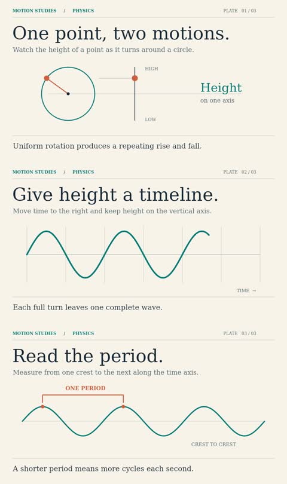
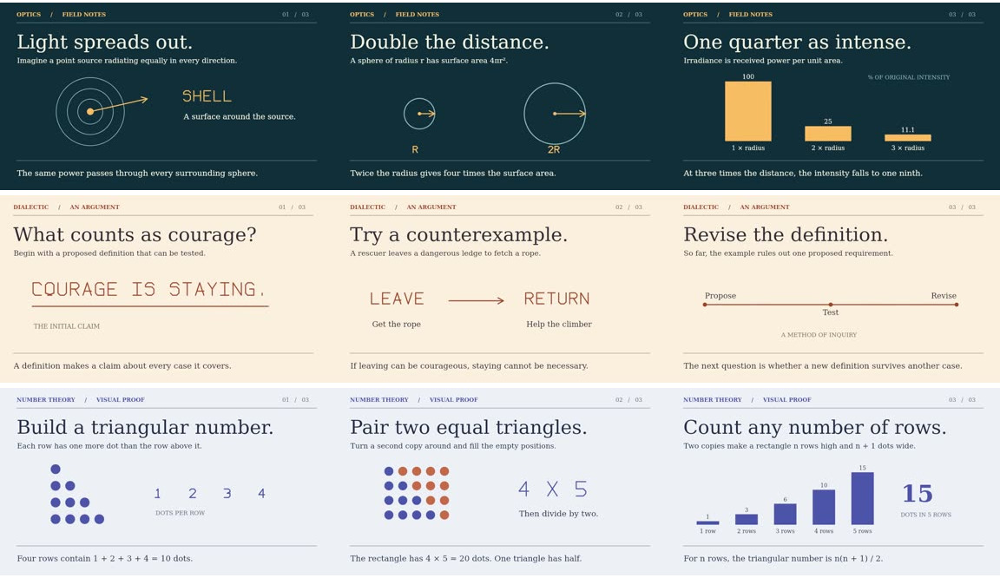

# AetherMotion

[Watch the complete 30-second lantern story](samples/evening-delivery.mp4) · [Six decoded frames](samples/evening-delivery-contact.jpg). A courier carries a lantern from the garden house, hangs it by the glasshouse and lowers the hand. The example combines coordinated travel, held props, camera framing, lighting and a quiet bell. [Reproduction guide](docs/CHOREOGRAPHY.md)


[Watch the character reaction study](samples/curiosity.mp4) · [Decoded frames](samples/curiosity-contact.jpg). Keyed head tilts, torso lean and blinking add reactions to the illustrated rig.


[Watch the courtyard greeting](samples/greeting.mp4) · [Decoded frames](samples/greeting-contact.jpg). Two illustrated characters use the refined walk and keyed wave control.


[Watch the illustrated courtyard character](samples/courtyard.mp4) · [Decoded frames](samples/courtyard-contact.jpg). A reusable shaded profile rig walks, stops and reaches toward a butterfly.


[Watch the revised balloon artwork](samples/ascent.mp4) · [Decoded frames](samples/ascent-contact.jpg). This 720×1280 visual study uses curved shapes, gradient shading and layered terrain. [Drawing API](docs/GRAPHICS.md)

Render an animated film locally from a versioned JSON file. The supplied 30-second physics film animates rotation, projection and period in three shots. Its graphics and camera are evaluated at exact frame indices. No API key is needed.



[Watch the vertical balloon study](samples/balloon.mp4). Its editable motion storyboard uses a 60×90 stage to fill the portrait frame. [Stage setup](docs/DIRECTOR.md#vertical-stages) · [Decoded frames](samples/balloon-contact.jpg)

## Watch the night mail train

[The last train to Bellwater](samples/night-post.mp4) tells a short story in three shots. The train, stamp and envelope move according to an [editable storyboard](examples/night-post/board.json). Compile the storyboard offline, or use the optional director with `--layout motion` to request the same format from Gemini. The film includes three local voice clips. [Reproduction commands](docs/DIRECTOR.md#motion-storyboards) · [Decoded frames](samples/night-post-contact.jpg)

## Watch the portrait geometry film

[The Missing Square](samples/missing-square.mp4) rearranges forty tiles and shows why nine more complete a seven-by-seven square. It uses the same renderer as the eclipse film. The three local voice clips ship with the example. After installation and build, run:

```sh
node dist/cli/main.js produce examples/missing-square.json out/missing-square --backend native --workers 2
python3 scripts/check_missing_square.py out/missing-square/film.mp4
```

[Six decoded frames](samples/missing-square-contact.jpg) · [Scene JSON](examples/missing-square.json) · [Verification](docs/VERIFICATION.md#portrait-reuse--the-missing-square)

## Watch the narrated eclipse film

[Download the 30-second MP4](samples/eclipse.mp4) · [View the decoded frames](samples/eclipse-contact.jpg) · [Read the scene JSON](examples/eclipse.json)

A single production command turns the authored film into a video, measures local speech, times the captions and bundles everything needed to render again. See [production setup and commands](docs/PRODUCE.md). To try it immediately using the checked-in signal narration:

```sh
node dist/cli/main.js produce examples/signal.json out/signal-production --backend native
```

## Install on Ubuntu or Linux Mint
Install Node.js 22.12 or later (including npm) via your usual Node version manager. Check both versions before installing dependencies.

```sh
sudo apt update
sudo apt install git ffmpeg fonts-liberation fonts-dejavu-core
git clone --branch feature/aethermotion-v0.1 https://github.com/SaridakisStamatisChristos/AetherMotion.git
cd AetherMotion
node --version
npm ci
npm run build
npm test
node dist/cli/main.js validate examples/wave.json
node dist/cli/main.js render examples/wave.json out/wave.mp4 --backend native
node dist/cli/main.js verify examples/wave.json out/wave.mp4
```

Native Canvas uses Skia on CPU. The default backend runs the same painter in headless Chromium. Install a Playwright browser once with `npx playwright-core install --with-deps chromium` or point `CHROMIUM_PATH` at a working system Chrome/Chromium executable. On Mint the system executable can be easier to install than Playwright's distribution-specific system packages.

```sh
node dist/cli/main.js render examples/wave.json out/wave-browser.mp4 --backend chromium --workers 2 --batch 3
```

The render command prints JSON metrics to standard output. Choose a fresh output filename. A failed render can be retried at the same destination. If Chromium reports a socket or sandbox startup failure in a container, use the native backend. For missing encoders check `ffmpeg -encoders` for libx264. For missing libraries on a new install, use the supported Node version and install optional npm dependencies. System fonts affect layout. Match fonts and toolchain versions when reproducing pixels.

## Authoring and extension
Start with examples/first-scene.json, a four-second moving circle. Copy an example JSON file, change its contents and run validate, render and verify. The schema rejects unknown actions. [Scene format and API](docs/SCENE.md) · [Architecture](docs/ARCHITECTURE.md) · [Reference and licensing](docs/RECONNAISSANCE.md) · [Verification](docs/VERIFICATION.md) · [Development status](docs/PROGRESS.md) · [Continuation](docs/CONTINUATION_CHECKPOINT.md).

## Three films from the same engine
[Light and distance](samples/light.mp4) · [A counterexample about courage](samples/courage.mp4) · [Triangular numbers](samples/triangles.mp4)



After building, run `python3 scripts/experiment.py out/experiment` on Linux to render all three, measure time and memory, hash the runtime around each production and write experiment.json. Supply an empty or new destination. Use `--backend chromium` to run the same experiment in Chromium. The complete scene specifications are in examples/. [Style authoring](docs/STYLES.md).

## Cartoon prototype
[View the eight-second pier scene](samples/pier.mp4). The original 2D actor walks, stops, points and opens its mouth according to JSON tracks. See examples/pier.json and the [style reference](docs/STYLES.md). The original pier example is silent. A second edition includes measured Kokoro speech, timed bells and burned-in captions.

## 3D and narrated samples

|Sample|What to look for|Download|
|---|---|---|
|Capsule|The camera travels around an imported eight-sided model, then the housing and rings separate.|[MP4](samples/capsule.mp4) · [frames](samples/capsule-contact.jpg)|
|Signal|A Kokoro voice introduces the signal. Three timed bells mark the lights. Captions appear during speech.|[MP4](samples/signal.mp4) · [SRT](samples/signal.srt)|

```sh
node dist/cli/main.js render examples/signal.json out/signal.mp4 --backend native
AETHER_WEBGL=software node dist/cli/main.js render examples/capsule.json out/capsule.mp4 --backend chromium
```

The narrated example ships its WAVs, so it runs immediately after the base install. The 3D example requires Chromium and WebGL 2. [Three.js authoring](docs/THREE.md) · [Narration and audio production](docs/AUDIO.md) · [Optional Gemini director](docs/DIRECTOR.md) · [Caller contracts](docs/ADAPTERS.md).
